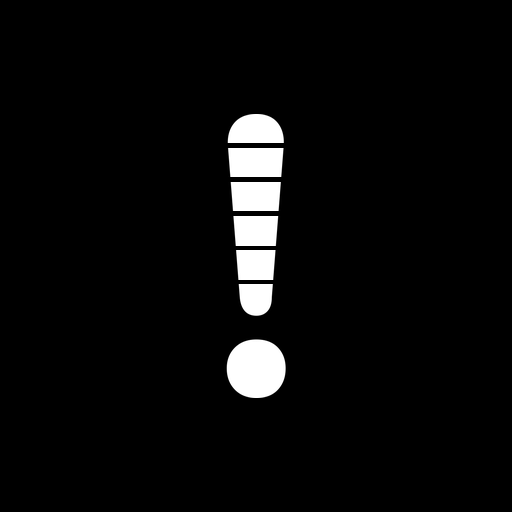

<div align="center">
  

  # EmuGo!

  A retro emulation frontend and home launcher for Android handhelds, inspired by the Analogue Pocket. Get it from [Releases](https://github.com/EmuGo-Frontend/android/releases/latest).

  <a href="https://apps.obtainium.imranr.dev/redirect?r=obtainium://add/https://github.com/EmuGo-Frontend/android"></a>
</div>

<br>

EmuGo! is a quiet, controller-first launcher: a centered list on black, one white selection pill, no sounds and no animations. Point it at your ROMs folder and it shows the systems you actually have. Older handhelds and consoles run inside the app through its own Libretro host. Newer ones hand off to the standalone emulators you already use.

It runs on Android 10 and newer, on arm64 devices. The interface is available in English and German.

## Getting started

1. Install the APK from the latest release.
2. Pick your ROMs folder when asked. EmuGo! looks for EmulationStation-style system folders such as `gb`, `gba`, `snes` or `psx`, including nested ones.
3. Choose your controller layout (Nintendo, Xbox or PlayStation) and, if you like, make EmuGo! your home launcher.

Cores are downloaded the first time you start a game for a system.

## Systems

| Runs inside EmuGo! | Core |
| --- | --- |
| Game Boy, Game Boy Color | gambatte |
| Game Boy Advance | mGBA |
| NES | Nestopia |
| Super Nintendo | Snes9x |
| Nintendo 64 | parallel_n64 (angrylion software renderer) |
| Genesis, Master System, Game Gear | Genesis Plus GX |
| PlayStation | PCSX ReARMed |

PlayStation discs (CUE/BIN, CHD, PBP) are read in place, without copying them into the app.

PS2, PSP, Nintendo DS, GameCube, Wii, 3DS and Switch games open in an installed standalone emulator, such as NetherSX2, PPSSPP, melonDS, Dolphin, Azahar or Eden. If you prefer RetroArch for the built-in systems, turn on Settings > Emulation > Use RetroArch.

## Your ROMs folder

Everything EmuGo! keeps lives next to your games, so syncing one folder carries your setup to another device.

```
ROMs/
├── bios/             optional BIOS files, see below
├── gb/ gba/ psx/ ... your games
└── emugo/
    ├── settings.json
    ├── saves/        battery saves, clocks and automatic states
    ├── screenshots/
    └── cores/
```

Battery saves are written as soon as a game changes them, and again when EmuGo! goes to the background. Game Boy Color cartridge clocks are kept in a matching `.rtc` file. Automatic save states are off by default.

Saves and states from RetroArch can be imported from Settings > Library.

### BIOS files

No BIOS is included. Put your own in `ROMs/bios/` to get the original boot intros:

| File | System |
| --- | --- |
| `gb.bin` | Game Boy |
| `gbc.bin` | Game Boy Color |
| `gba.bin` | Game Boy Advance |
| `ps1.bin` | PlayStation |

Settings > Emulation > Boot intros skips them again. Without `ps1.bin`, PlayStation games use the core's built-in open-source BIOS.

## Around the launcher

| Button | Action |
| --- | --- |
| D-pad | Move |
| A | Select |
| B | Back |
| R / RB | Infocenter |
| ZL/ZR, LT/RT | Jump through long lists |
| Start + Select | Game menu (configurable) |

The **Infocenter** shows Wi-Fi and Bluetooth status, volume, brightness, now-playing controls and your notifications.

**Screenshots** are taken from the pause menu and collected in an album on the Home screen. From the viewer you can delete or share them.

The Game Boy and Game Boy Color can use a green palette, a dot-matrix or LCD overlay, and frame blending, all under Settings > Emulation > Display modes. Every other system scales to the largest sharp picture that keeps its aspect ratio.

Themes include Nord, Dracula, Catppuccin, Tokyo Night and others, plus TechDweeb wallpapers and custom backgrounds.

## RetroAchievements

Sign in under Settings > Integrations > RetroAchievements. Achievements work for every built-in system in softcore mode:

- unlock, leaderboard and mastery notifications, which can be turned off
- an Achievements page in the pause menu
- rich presence on your RetroAchievements profile

Home > RetroAchievements opens your profile inside EmuGo!, with your points and per-game progress. Press X to reload it. Press Start on a game to launch it from your library.

## Discord

Settings > Integrations > Discord shows what you are playing on your Discord profile, including the RetroAchievements status line and the game's icon.

Sign-in uses OAuth2 with PKCE, so the app holds no client secret. If you build EmuGo! under your own Discord application, enable Public Client and add this redirect URI in the developer portal:

```
http://127.0.0.1:53134/callback
```

## Building

You need the Android SDK and Java 17 or newer. On the first build Gradle installs the matching SDK platform, NDK and CMake by itself.

```sh
./gradlew :app:assembleDebug
```

Discord support needs the Discord Social SDK, which is not part of this repository. Unpack it once with `sh scripts/prepare-discord-sdk.sh /path/to/DiscordSocialSdk.zip`. Builds without it work, just without Discord.

Release builds are signed with credentials from the environment, never from files in the repository:

```sh
SIGNING_KEYSTORE=/path/to/keystore.jks \
SIGNING_STORE_PASSWORD=... \
./gradlew :app:assembleRelease
```

`SIGNING_KEY_ALIAS` defaults to `upload`, and `SIGNING_KEY_PASSWORD` to the store password. The signed APK is written to `app/build/outputs/apk/release/app-release.apk`.

Interface text lives in `app/src/main/res/values/strings.xml`, with the German translation in `values-de/strings.xml`.

## Syncing

EmuGo! works well with [Syncthing](https://play.google.com/store/apps/details?id=com.github.catfriend1.syncthingandroid). Share the whole ROMs folder, `emugo/` included, and your library, saves and settings follow you between devices. Settings > Integrations > Syncthing shows its status.

`settings.json` holds your RetroAchievements login token, so only share the folder with devices you trust.

## Known limits

- The built-in host only runs software-rendered cores.
- N64 uses a software renderer and does not reach full speed in every game.
- Standalone emulators decide for themselves how they handle launch requests, so some versions may not open games directly.

## License

EmuGo! is released under the MIT License. It includes rcheevos and Tabler Icons (MIT) and the Nunito font (SIL OFL 1.1). The TechDweeb wallpapers are included with permission. Libretro cores are downloaded separately and keep their own licenses. Third-party notices are in [`notices/`](notices/) and on the OSS licenses page inside the app.
